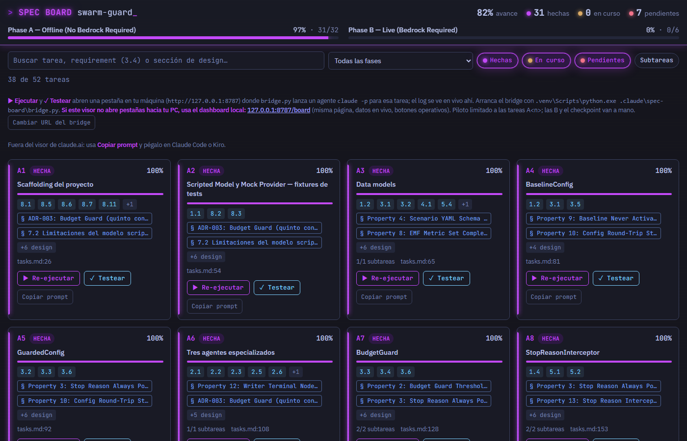

# spec-board

Un semáforo de tareas para specs de [Kiro](https://kiro.dev), pensado para el flujo
**"Kiro escribe la spec, Claude Code la ejecuta y la valida"**.

Lee `.kiro/specs/<spec>/tasks.md` y lo convierte en un tablero con progreso por fase, trazabilidad a
`requirements.md` y `design.md`, y un botón por tarea que lanza un agente de Claude Code acotado para
implementarla o verificarla. Se presenta en dos vistas sincronizadas:

- un **panel dentro de Claude Code** (mod), al lado del chat, y
- un **dashboard web local** servido por un bridge en `127.0.0.1:8787`.



## Por qué existe

Trabajar con specs largas tiene dos fricciones:

1. **Saber dónde estás.** `tasks.md` crece a decenas de tareas con subtareas, fases y referencias
   cruzadas. Leerlo cada vez para saber qué falta, qué está a medias y qué requirement cubre cada tarea
   cuesta más que la tarea en sí.
2. **Ejecutar sin perder el control.** Dejar que un agente implemente tareas de forma autónoma es
   cómodo, pero darle permisos amplios sobre el repo, git y la nube no lo es.

spec-board resuelve lo primero con una vista derivada del spec, sin estado propio: el tablero se
regenera a partir de los archivos y nunca los modifica. Y lo segundo con un bridge que lanza cada tarea
como un proceso `claude -p` independiente, con una lista blanca de herramientas y solo para las tareas
que tú autorices por expresión regular.

## Cómo funciona

```
.kiro/specs/<spec>/            Kiro escribe aquí (tasks.md, requirements.md, design.md)
        │
        │  lectura (nunca escritura)
        ▼
┌──────────────────────┐   HTTP JSON    ┌──────────────────────────────┐
│  mod (Claude Code)   │ ◄────────────► │  bridge.py  (127.0.0.1:8787) │
│  panel + /spec-board │                │  /board /run /jobs /regen    │
└──────────────────────┘                └──────────────┬───────────────┘
        ▲                                              │ genera data.js
        │ hooks / tsx                                  │ lanza `claude -p` por tarea
        │                                              ▼
   Claude Code                       <proyecto>/.claude/spec-board/  (data.js, index.html, runs/*.log)
```

- `gen_spec_data.py` parsea el spec y produce `data.js`: tareas, subtareas, estado, porcentaje, fases,
  y los enlaces a requirements y secciones de design que menciona cada tarea.
- `bridge.py` sirve el dashboard (`index.html` + `data.js`) y expone una API mínima. Al pulsar
  **Ejecutar** o **Testear** construye un prompt con la tarea, su criterio de verificación y sus
  referencias, y lanza `claude -p` con un `--allowedTools` cerrado. El log de cada ejecución se ve en vivo
  en el navegador.
- El **mod** dibuja el mismo tablero dentro de Claude Code, detecta cambios en el spec cada pocos
  segundos, muestra el avance en la línea de estado, avisa con toasts cuando una tarea cambia de estado o
  una ejecución termina, y ofrece el comando `/spec-board`.

El estado de una tarea sale del propio `tasks.md` (`[ ]`, `[-]`, `[x]`); el porcentaje se calcula por
subtareas, o se puede fijar a mano desde el mod para tareas sin subtareas.

## El mod de Claude Code

Se carga con `claude --plugin-dir ..\spec-board\mod`. Al iniciar la sesión abre el panel **Spec board**:
una barra de avance por spec, las fases con su cuenta, y cada tarea con su semáforo. Las tareas dentro del
alcance del bridge tienen botones ▶ (ejecutar) y ✓ (testear); al pulsar una tarea se abre su detalle con
el criterio de verificación y la línea de `tasks.md` donde vive.

Comando `/spec-board`:

| Uso | Efecto |
| --- | --- |
| `/spec-board` | Abre o enfoca el panel |
| `/spec-board <tarea>` | Muestra el detalle de la tarea |
| `/spec-board <tarea> <0-100>` / `<tarea> clear` | Fija o borra un porcentaje manual |
| `/spec-board run <tarea>` / `test <tarea>` | Encola la tarea en el bridge (implementar / solo verificar) |
| `/spec-board run <tarea> here` | Lo mismo, pero dentro de la sesión actual en vez del bridge |
| `/spec-board jobs` | Estado de las ejecuciones del bridge |
| `/spec-board bridge` | Comprueba el bridge y lo arranca si está caído |
| `/spec-board refresh` | Relee el spec y regenera `data.js` |
| `/spec-board auto on` / `auto off` | Activa o desactiva la regeneración automática del dashboard |
| `/spec-board publish` | Publica el dashboard como Artifact de claude.ai (la única acción que gasta un turno de modelo) |

## El dashboard web

`http://127.0.0.1:8787/board`. Misma información que el panel, con buscador (por tarea, número de
requirement o sección de design), filtro por fase y estado, tarjetas con los chips de trazabilidad, y un
cajón lateral con el detalle de cada tarea. Los botones **Re-ejecutar** / **Testear** llaman al bridge;
**Copiar prompt** copia el mismo encargo para pegarlo a mano en Claude Code o Kiro.

El dashboard también puede publicarse como Artifact de claude.ai para compartirlo; desde ahí los botones
siguen apuntando a tu bridge local, así que solo operan en tu máquina.

## El bridge

| Ruta | Función |
| --- | --- |
| `GET /board` | Dashboard (regenera `data.js` en cada carga) |
| `GET /runs` | Tareas permitidas y ejecuciones recientes |
| `GET /run?task=A24&mode=run` | Implementa la tarea. `mode=test` solo verifica; `&dry=1` muestra prompt y comando sin lanzar nada; `&json=1` responde JSON |
| `GET /regen` | Regenera `data.js` |
| `GET /jobs.json`, `GET /job/<id>/json`, `GET /job/<id>/raw` | Estado y log de los trabajos |
| `GET /health` | Comprobación de vida |

### Límites de seguridad

Cada ejecución del bridge es un `claude -p` separado que:

- recibe solo una **lista blanca** de herramientas (`--allowedTools`), nunca
  `--dangerously-skip-permissions`;
- no puede hacer `git commit`, `git push` ni borrar archivos;
- no tiene acceso a red ni a la AWS CLI, y arranca con las variables `AWS_*` eliminadas del entorno;
- solo acepta tareas cuyo id cumpla `allowedTasks` (por defecto `^A\d+(\.\d+)?$`);
- escucha únicamente en `127.0.0.1`.

Las tareas que requieran credenciales, despliegues o decisiones humanas se dejan fuera del patrón y se
hacen a mano o con `/spec-board run <tarea> here`, dentro de una sesión interactiva donde tú apruebas cada
herramienta.

## Instalación y uso

Requisitos: Windows (el arranque es un `.cmd`; bridge y generador son Python puro), Python 3.11+ y
[Claude Code](https://claude.com/claude-code).

1. Clona este repo al lado de tu proyecto:

   ```
   D:\Demos\
   ├── spec-board\      ← este repo
   └── mi-proyecto\     ← tiene .kiro\specs\<spec>\tasks.md
   ```

2. En la raíz de tu proyecto crea `.claude/spec-board.json` (todos los campos son opcionales):

   ```json
   {
     "specsDir": ".kiro/specs",
     "spec": "mi-spec",
     "pollMs": 4000,
     "allowedTasks": "^A\\d+(\\.\\d+)?$",
     "bridge": {
       "url": "http://127.0.0.1:8787",
       "autoStart": true,
       "start": [".venv/Scripts/python.exe", "../spec-board/bridge/bridge.py"],
       "claudePath": "~/.local/bin/claude.exe"
     },
     "dashboard": {
       "dir": ".claude/spec-board",
       "generator": "../spec-board/bridge/gen_spec_data.py",
       "python": ".venv/Scripts/python.exe",
       "artifactUrl": ""
     }
   }
   ```

   `dashboard.dir` recibe los archivos generados por proyecto (`data.js`, copia de `index.html`,
   `runs/`); conviene tenerlo en `.gitignore`.

   `bridge.claudePath` solo hace falta si `claude` no está en el PATH. El bridge resuelve el
   ejecutable en este orden: `claude` en el PATH, luego `bridge.claudePath` (admite `~` y variables de
   entorno). Si no lo encuentra, no arranca y explica cómo configurarlo.

3. Desde la raíz del proyecto:

   ```bat
   ..\spec-board\start.cmd            REM bridge + Claude Code con el mod, continúa la última sesión
   ..\spec-board\start.cmd <session>  REM reanuda una sesión concreta
   ```

   O por separado: `python ..\spec-board\bridge\bridge.py` para el bridge (toma el proyecto del
   directorio actual o de `SPEC_BOARD_REPO`) y `claude --plugin-dir ..\spec-board\mod` para el mod.

## Qué parsea del spec

- Tareas de la forma `- [ ] A7 Título`, `- [-]` (en curso) y `- [x]` (hecha), con subtareas anidadas
  por indentación.
- Cada encabezado `## ...` de `tasks.md` abre una fase; el avance se calcula por fase y en total.
- Referencias `_Requirements: 3.1, 3.4_` bajo cada tarea, y menciones a secciones o propiedades de
  `design.md` dentro de su texto.
- Un bloque `**Criterio de verificación:**` por tarea, que el bridge incluye en el prompt del agente y
  el modo `test` usa como contrato.

Si tu spec usa otras convenciones, el punto de entrada es `parse_tasks()` en `bridge/gen_spec_data.py`.

## Desarrollo

```bat
claude plugin validate mod
claude plugin test mod
python bridge\gen_spec_data.py <ruta-al-spec> <carpeta-salida> [nombre-del-repo]
```

### Tests del mod

Los tests viven junto al código del mod (`mod/hooks/*.test.tsx`) y los ejecuta el propio motor de Claude
Code, sin instalar nada más:

```bat
claude plugin validate mod     REM comprueba manifiesto, hooks y el contrato de estado
claude plugin test mod         REM ejecuta los tests del mod en un motor aislado
```

Requiere Claude Code 2.1.3xx o superior. Si `claude` no está en el PATH, usa la ruta completa del
ejecutable (la misma que pondrías en `bridge.claudePath`).

`mod/.claude-plugin/types/` lo escribe el motor de Claude Code al cargar el mod y está ignorado por git.
El mod está escrito contra la API de mods de Claude Code (hooks `session.start`, `command.run`,
`ui.render`, estado con `atom`) y usa `claude plugin test` para sus pruebas.

## Estado y limitaciones

- Nació como herramienta interna del proyecto [swarm-guard](https://github.com/miguelgrasso/swarm-guard)
  y se extrajo a este repo en noviembre de 2026. Está probado con un solo spec por proyecto.
- `start.cmd` es de Windows; en otros sistemas arranca bridge y mod a mano.
- El bridge no tiene autenticación: por eso escucha solo en localhost y no debe exponerse.

## License

Este proyecto se distribuye bajo la licencia [Apache 2.0](LICENSE).
